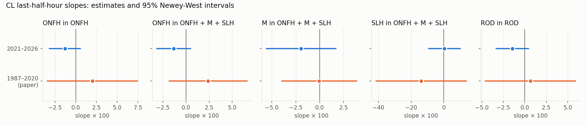
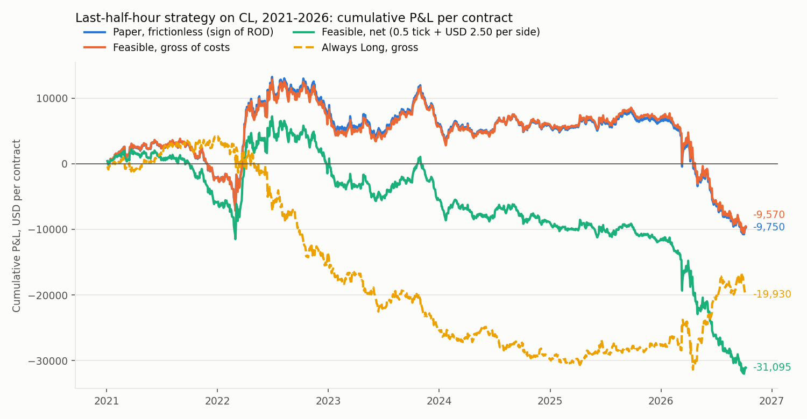
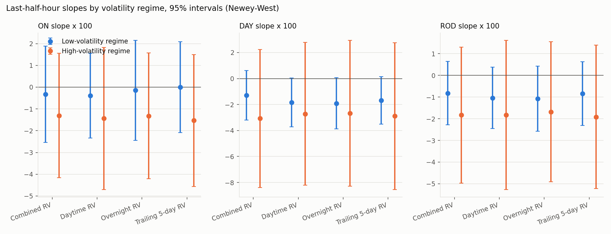
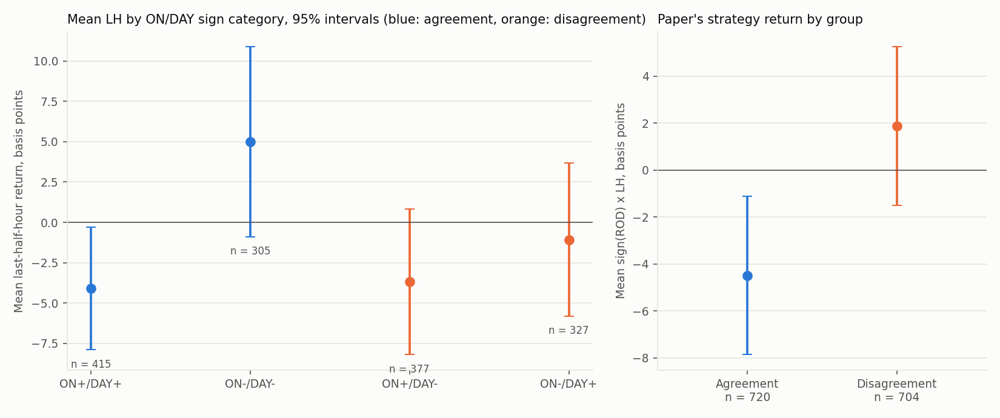
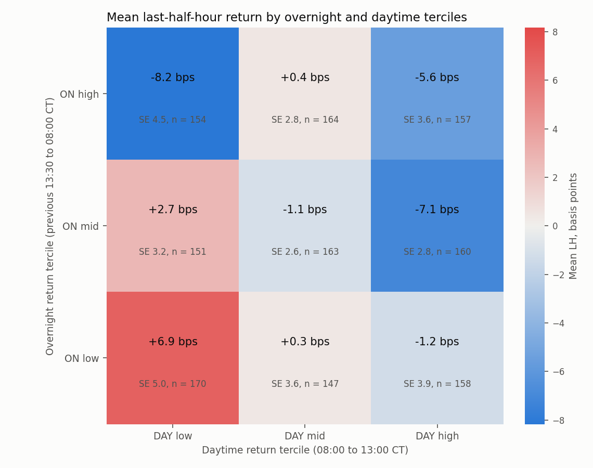

# WTI Crude Oil Intraday Momentum after 2020: Replication of Baltussen et al. (2021) and Three New Hypotheses

Group 3, FINM 37000 Futures and Related Derivatives. Draft of the final project report (#33). Every number below is read from a saved table in `reports/tables/` produced by a script in `src/` from a configuration in `config/`; the "Where it comes from" column of each results table names the file. Section 8 gives the commands that regenerate everything.

> **Status.** Sections 4.1, 4.2, 4.4 and 4.5 are complete (#29, #30, #32, #33). Section 4.3 (overnight versus daytime, #31) and Section 4.6 (subperiods, #38) are open issues; their subsections state what will go there and show the preview results that already exist.

## 1. Question and answer in brief

Baltussen, Da, Lammers and Martens (2021, *Journal of Financial Economics*) find **market intraday momentum** in futures: the return from the previous close to 30 minutes before the close (the rest-of-day return, ROD) positively predicts the return of the last half hour (LH). They attribute it to hedging demand from investors with short-gamma exposure, who must trade in the direction of the day's move before the close. Crude oil (CL) was one of their markets, but CL on its own was never significant (Appendix Table B3: slope × 100 of 0.67, t = 0.25, out-of-sample R² −1.04%).

We ask four things about CL from January 2021 to October 2026, using one-minute data for the full electronic session:

| Question | Issue | Answer |
|---|---|---|
| Does the paper's momentum relationship hold for CL after 2020? | #29 | **No.** All three slopes are slightly negative and every 95% interval includes zero (ROD slope × 100: −1.46 [−3.35, 0.43]). The only positive out-of-sample R² (ROD, 0.37%) is not distinguishable from zero and turns negative without one day, 10 March 2026. |
| Can the sign of ROD be traded in the last half hour? | #30 | **No.** Before costs the strategy earns −1.2 basis points a day (SE 1.3); with USD 15 of costs per round trip, −3.1 (1.3) and a Sharpe ratio of −1.1. No cost assumption makes it profitable because the gross return is already negative. |
| Do overnight and daytime returns predict differently? | #31 | **Open.** In the preview from #32, LH ~ ON + DAY gives ON −1.0 (1.1) and DAY −2.3 (1.6) on 1,186 dates: both slightly negative, neither distinguishable from zero or from each other. |
| Does the relationship change in high-volatility regimes? | #32 | **No measurable change.** The ON and DAY slopes are more negative on high-volatility days, but the differences (−1.0 (1.8) and −1.8 (2.9)) are far from significant and the interaction models forecast worse out of sample. |
| Does agreement between the overnight and daytime directions matter? | #33 | **Yes, and in the opposite direction to the paper's story.** When ON and DAY agree, the last half hour reverses: the paper's strategy earns −4.5 (1.7) basis points on agreement days against +1.9 (1.8) on disagreement days, difference −6.4 (2.3), p = 0.007 (Bonferroni level 0.010). The interaction raises the out-of-sample R² from 0.37% to 0.75% (Clark-West p = 0.05). The effect is concentrated in the two high-volatility years, 2022 and 2026. |
| Did the relationship differ between 2021–2023 and 2024–2026? | #38 | **Open.** |

The overall picture: in post-2020 CL there is no intraday momentum to replicate, no tradable strategy, and the one new regularity we find is a **reversal on unambiguous days** that is statistically modest and tied to crisis years. These are null and negative findings, and the project's success criterion (reproducible results that a teammate can regenerate) does not depend on the sign of the result.

## 2. Data

| Item | Value | Source |
|---|---|---|
| Market | NYMEX WTI crude oil futures (CL), outright contracts | Databento `GLBX.MDP3` |
| Frequency and coverage | 1-minute OHLCV bars, full Globex session (17:00–16:00 CT), 2020-12-02 to 2026-10-07; 1,469 trade dates, 3.9 million held-contract minutes | `data/README.md`, `reports/tables/cl_intraday_coverage.csv` |
| Replication sample | **1,436 trade dates, 2021-01-04 to 2026-10-07**, after the paper's filters (no early closes, volume ≥ 100 contracts; 12 dates excluded, all around Thanksgiving and Christmas) | `data/processed/cl_return_features_summary.csv` |
| Held contract | The paper's rule: the most liquid contract, rolled at the next open after the next month's session volume first exceeds it (69 rolls in the sample; 1–2 sessions later than a 3-sessions-before-expiry rule) | `data/processed/cl_minute_roll_calendar.csv` |
| Reference prices | At each reference time T the price is the close of the held contract's last 1-minute bar starting before T, so the 13:00 price contains no trade from 13:00 on. Every price on trade date t, including the previous 13:30 close, is from the contract held on t, so no return crosses a roll | `reports/minute_dataset_handoff.md` |
| Quality | No missing values, duplicates, OHLC inconsistencies or non-positive prices; 13 Databento degraded dates flagged and kept; the 13:00 and 13:30 bars traded on every sample date | `data/processed/cl_minute_quality_summary.csv` |

The raw files are licensed and stay local; their manifests (query, time, SHA256) are committed. The processed data is committed through Git LFS, so a teammate needs no API key.

## 3. Definitions and methods

**Session and returns.** The paper's CL window is 09:00–14:30 ET, which is 08:00–13:30 America/Chicago; 13:30 CT is the reference close, not the 16:00 CT end of the electronic session. With P(t, T) the price of the held contract at Chicago time T on trade date t:

| Variable | Interval (CT) | Role |
|---|---|---|
| ON | previous 13:30 → 08:00 | overnight return (new hypotheses) |
| ONFH | previous 13:30 → 08:30 | paper's opening predictor |
| M, SLH | 08:30 → 12:30, 12:30 → 13:00 | paper's middle and second-to-last half hour |
| ROD | previous 13:30 → 13:00 | paper's rest-of-day predictor; (1 + ON)(1 + DAY) = 1 + ROD |
| DAY | 08:00 → 13:00 | daytime return (new hypotheses) |
| LH | 13:00 → 13:30 | target: the last half hour |

Simple returns throughout, as in the paper; log returns are used only as labeled robustness variants. The decision time is 13:00 CT: every configuration loader rejects a predictor or feature that uses a later price, and tests change all prices from 13:00 on and confirm that no predictor, volatility feature or trading signal moves.

**Inference.** Slopes are reported × 100 with Newey-West standard errors (7 lags, the automatic rule ⌊4(n/100)^(2/9)⌋ for 1,436 observations, with the n/(n−k) correction) and 95% intervals. Following the instructor's check-in note, estimates with standard errors and plots over time are reported in preference to significance tests; where several hypotheses are tested, the Bonferroni level is given.

**Out of sample.** Expanding-window forecasts after the paper's minimum of 500 observations (first forecast 2023-01-04, 936 forecasts), compared with the expanding historical mean by the out-of-sample R² (paper Eq. 8) and the Clark-West test (Eq. 9); nested models are also compared with each other.

**Trading.** One contract, USD 1,000 per 1.00 of price. Entry at the first held-contract trade at or after 13:00 CT and exit at the first trade at or after 13:30 CT (both bars traded on every sample day). Costs: USD 2.50 commission and 0.5 tick of spread and slippage per side, USD 15 per round trip, with a grid from 0 to 3 ticks. There are no quotes in the data, so the spread is a proxy. A trade-at-settlement exit variant, which pays no exit spread, is also reported.

**Volatility.** Realized variance from 1-minute log returns of the held contract over the overnight and daytime windows, with returns across scheduled halts (the 16:00–17:00 CT daily halt, weekends, holidays) recorded separately rather than summed. Regimes use an expanding upper-quartile threshold so the label on date t uses only earlier dates.

## 4. Results

### 4.1 Replication of the paper's regressions (#29)

Slopes × 100 with 95% intervals; adjusted and out-of-sample R² in percent. The paper's intervals are implied from its slopes and t-statistics. Where it comes from: `replication_vs_paper.csv`, `replication_regressions.csv`.

| Model | Slope | Paper, CL 1987–2020 | Ours, CL 2021–2026 | Adj. R², paper / ours | OOS R², paper / ours |
|---|---|---|---|---|---|
| LH ~ ONFH | ONFH | 2.00 [−3.44, 7.44] | **−1.30** [−3.16, 0.57] | 0.17 / 0.24 | −0.48 / −0.42 |
| LH ~ ONFH + M + SLH | ONFH | 2.40 [−1.80, 6.60] | **−1.32** [−3.15, 0.51] | 1.25 / 0.46 | −1.77 / −1.49 |
| | M | −0.06 [−3.98, 3.86] | −1.94 [−5.58, 1.70] | | |
| | SLH | −13.95 [−41.57, 13.67] | 0.38 [−9.33, 10.09] | | |
| LH ~ ROD | ROD | 0.67 [−4.58, 5.92] | **−1.46** [−3.35, 0.43] | 0.03 / 0.52 | −1.04 / 0.37 |

- Every post-2020 slope is slightly negative and every interval includes zero; each differs from the paper's estimate by at most 1.6 standard errors. The negative sign holds in every calendar year but 2025, under 0 to 20 Newey-West lags, under both roll rules and under every exclusion.
- ROD's positive out-of-sample R² is not significant (Clark-West one-sided p = 0.16) and depends on 10 March 2026, a crisis-day reversal during the Strait of Hormuz closure (ROD −15.4%, LH +4.6%); without that one forecast the OOS R² is −0.22%, and dropping the day moves the full-sample ROD slope from −1.46 to −0.67 (0.66).
- Conclusion of the replication: no evidence of intraday momentum in CL after 2020, consistent with the paper's own insignificant CL result.



### 4.2 The last-half-hour trading strategy with costs (#30)

The paper's timing strategy (its Eq. 12): long over the last half hour when ROD > 0, short otherwise, reported without costs. Means in basis points of notional per day with HAC standard errors; P&L in USD per contract over 1,435 traded days. Where it comes from: `lh_strategy_summary.csv`, `lh_strategy_cost_sensitivity.csv`, `lh_strategy_robustness.csv`.

| Accounting | Mean (SE) | 95% interval | Sharpe (SE) | Hit rate | Total P&L | Max drawdown |
|---|---|---|---|---|---|---|
| Paper's convention, frictionless | −1.18 (1.26) | [−3.7, 1.3] | −0.40 (0.42) | 0.480 | | |
| Feasible fills, gross | −1.15 (1.26) | [−3.6, 1.3] | −0.39 (0.42) | 0.481 | −9,570 | 23,380 |
| Feasible fills, net of USD 15 per round trip | −3.15 (1.26) | [−5.6, −0.7] | −1.07 (0.42) | 0.466 | −31,095 | 39,235 |
| Always Long (paper's benchmark), gross | −1.33 (1.17) | [−3.6, 1.0] | −0.45 (0.42) | 0.483 | −19,930 | 35,520 |

- Execution delay costs nothing measurable (next-trade fills differ from the paper's reference prices by 0.03 basis points); the spread does: each tick per side costs 2.7 basis points a day. The gross mean is already negative, so there is no breakeven cost. A trade-at-settlement exit improves the net mean to −2.26 (1.23) and does not change the conclusion.
- 770 long and 665 short days earn the same mean as Always Long: the sign of ROD carries no direction information. Robustness variants (skipping roll dates, expiry-adjacent sessions, degraded dates, sessions after a weekend, or 10 March 2026) keep the gross mean between −1.2 and −0.2 basis points. 2026 is the only year whose interval excludes zero (−10.5 [−17.9, −3.1]).
- The paper's commodity portfolio earned a Sharpe ratio of 1.42 on this signal over 1974–2020 (its Table 6); CL alone after 2020 earns −0.4 before costs.



### 4.3 Overnight versus daytime predictability (#31, open)

This section will report LH ~ ON, LH ~ DAY, LH ~ ON + DAY and the ROD benchmark with standardized coefficients, a Wald test of coefficient equality, expanding-window OOS R² and stability by year and roll rule. The base model already estimated in #32 and #33 is the preview (where it comes from: `volatility_regimes_regressions.csv`, `sign_agreement_regressions.csv`):

| Sample | ON slope × 100 (SE) | DAY slope × 100 (SE) | Adj. R² (%) | OOS R² (%) |
|---|---|---|---|---|
| 1,436 dates (#33) | −1.26 (1.01) | −1.84 (1.43) | 0.52 | −0.29 |
| 1,186 dates from 2022 (#32) | −1.02 (1.08) | −2.29 (1.59) | 0.62 | 0.35 |

Neither component predicts the close on its own, and the two slopes are within one standard error of each other.

### 4.4 Volatility regimes (#32)

A date is high volatility when its realized variance (previous 13:30 → 13:00 CT, from 1-minute returns) exceeds the upper quartile of the earlier dates; 336 of 1,186 dates from 2022 qualify, mostly in 2022 and 2026. High-volatility dates have an LH standard deviation of 0.70% against 0.37%. Slopes × 100 with standard errors. Where it comes from: `volatility_regimes_slopes.csv`, `volatility_regimes_oos.csv`.

| Predictor | Low-volatility slope | High-volatility slope | High − low (SE), p | Wald p (both interactions) |
|---|---|---|---|---|
| ON | −0.33 (1.13) | −1.30 (1.46) | −0.97 (1.84), 0.60 | 0.78 |
| DAY | −1.29 (0.97) | −3.07 (2.71) | −1.79 (2.94), 0.54 | |
| ROD | −0.82 (0.75) | −1.83 (1.60) | −1.01 (1.77), 0.57 | |

- Daytime, overnight and trailing 5-day variance regimes give the same picture; none of the eight interaction p-values is below 0.41 (Bonferroni level 0.006). Without 10 March 2026 the high-regime differences shrink to −0.07 and +0.70.
- Out of sample, adding the regime terms to LH ~ ON + DAY lowers the OOS R² from 0.35% to between −0.6% and −1.2%; the loss is concentrated in March 2026, when slopes estimated on 2022 met the 2026 crisis.
- The volatility features themselves are a deliverable: overnight realized variance was computable for every date because the full electronic session is in the data, and reopening jumps (15% of overnight squared returns) are separated from the diffusive variance.



### 4.5 Sign agreement between overnight and daytime returns (#33)

At 13:00 CT the signs of ON and DAY classify each day as agreement (ON+/DAY+, ON−/DAY−; 720 days) or disagreement (ON+/DAY−, ON−/DAY+; 704 days); 12 zero-return days are set aside. The paper's strategy return η = sign(ROD)·LH, in basis points with HAC standard errors. Where it comes from: `sign_agreement_categories.csv`, `sign_agreement_regressions.csv`, `sign_agreement_oos.csv`, `sign_agreement_strategies.csv`.

| Group | n | Mean LH (SE) | η = sign(ROD)·LH (SE) | LH follows ROD |
|---|---|---|---|---|
| ON+/DAY+ | 415 | −4.11 (1.90) | −4.11 (1.90) | 0.470 |
| ON−/DAY− | 305 | 4.99 (3.06) | −5.00 (3.06) | 0.469 |
| ON+/DAY− | 377 | −3.69 (2.29) | 2.10 (2.32) | 0.509 |
| ON−/DAY+ | 327 | −1.07 (2.48) | 1.62 (2.43) | 0.462 |
| Agreement − disagreement | 1,424 | | **−6.36 (2.34)**, p = 0.007 | −0.018 |

- On agreement days the close moves against the day; on disagreement days the mean LH carries no information about the sign of ROD. Hit rates stay near one half in every group: the difference is in the size of the moves.
- The two-dimensional view asked for in the check-in gives the same answer without a threshold: the product ON×DAY enters LH ~ ON + DAY + ON×DAY with slope × 100 of 108 (47), and on the ON × DAY tercile grid the agreement corners are the most negative strategy cells (ON high/DAY high −5.6 basis points of LH, ON low/DAY low +6.9). The effect sits in the daytime leg: the DAY slope is +3.6 (1.5) on disagreement days and −6.5 on agreement days (DAY×Agree −10.1 (3.4)).
- Out of sample, LH ~ ROD + Agree + ROD×Agree is the only model in the project that improves on the paper's ROD model: OOS R² 0.75% against the historical mean (Clark-West p = 0.052) and 0.38% against the nested ROD model (p = 0.056).
- The result does not depend on one day or on the roll rule (difference between −5.7 and −7.2 under every exclusion), but it is a 2022 and 2026 result: −21 (8) and −12 (7) basis points in those years, within ±6 of zero in the others.
- Trading the sign of ROD only on disagreement days is flat after costs (−0.08 (0.84) basis points, USD +3,055) where the unfiltered baseline loses USD 31,095; the filter is chosen with hindsight and does not create a profit.





### 4.6 Subperiods 2021–2023 versus 2024–2026 (#38, open)

This section will re-estimate the three paper specifications in the two nonoverlapping periods, test the coefficient difference with a pooled regression and subperiod interactions, and discuss Bogoev (2025), who reports a positive WTI rest-of-day relationship for 2019–2023 with a different sample and specification.

## 5. What drives the results: three recurring facts

1. **10 March 2026.** One crisis-day reversal (ROD −15.4%, LH +4.6%) accounts for more than half of the negative full-sample ROD slope, for all of ROD's positive out-of-sample R², for the worst strategy day (−USD 3,685), and for much of the volatility-regime point estimates. It is genuine data (the next contract made the same moves) and stays in every baseline; every write-up shows the result without it.
2. **2022 and 2026.** The two high-volatility years hold most high-volatility dates and all of the sign-agreement effect. The project's one positive finding is therefore about how CL closes on large one-directional days during crises, not a general feature of the market.
3. **Roll convention and inference choices do not matter.** The paper's volume-crossover rule and the 3-sessions-before-expiry rule differ on 127 days and move no estimate by more than 0.05; Newey-West lags from 0 to 20 change standard errors by at most 10%.

## 6. Limitations

- **One market, six years, two crises.** The sample is 1,436 days against the paper's 8,336, and its regime variation comes from two episodes.
- **No quotes.** Trading costs use a spread proxy and a grid; the trade-at-settlement variant bounds what removing the exit spread is worth.
- **Multiple hypotheses.** Three new hypotheses with several specifications each. The sign-agreement result clears a Bonferroni level in sample and sits at p ≈ 0.05 out of sample; it should be read as a lead for future work, not an established effect.
- **Open sections.** #31 and #38 are pending; the preview in 4.3 is from models estimated for other purposes.
- **Reversal mechanism.** The reversal on agreement days is consistent with profit-taking or inventory unwinding before the reference close, but nothing in the data identifies who trades.

## 7. Differences from the paper

| Item | Paper (CL) | This project |
|---|---|---|
| Period, observations | 1987–2020, 8,336 days | 2021–2026, 1,436 days |
| Data | Tick Data intraday prices | Databento 1-minute bars, full Globex session |
| Trading window | 09:00–14:30 ET | 08:00–13:30 CT (the same clock times) |
| Contract and roll | most liquid contract, volume-crossover roll | the same, with session volume from the minute bars; 3-day pre-expiry rule as robustness |
| Standard errors | Newey-West, lag length not stated | Newey-West, 7 lags, n/(n−k) correction; 0–20 lags as robustness |
| Out of sample | expanding window, at least 500 observations | the same; first forecast 2023-01-04 |
| Strategy | frictionless | next-trade fills, commission and spread grid, trade-at-settlement variant |
| Uncertainty | t-statistics | standard errors and 95% intervals, plots over time |

## 8. Reproducing the project

**Environment.** Python 3.11 with the pinned `requirements.txt` in a virtual environment; Git LFS for the processed data. No Databento key is needed unless the raw files are re-downloaded.

```bash
git clone https://github.com/gwino/futures-project-group3.git && cd futures-project-group3
python -m venv .venv && .venv/Scripts/activate        # source .venv/bin/activate on macOS/Linux
python -m pip install -r requirements.txt
git lfs pull
```

**Pipeline, in order.** Each step reads the previous step's committed outputs, so any step can be run on its own.

| Step | Command | Writes |
|---|---|---|
| Minute dataset, reference prices, rolls (#25–#27) | `python -m src.prepare_minute_data --config config/prepare_minute.yaml` (needs the raw `.dbn` files) | `data/processed/cl_minute_*` |
| Return features (#28) | `python -m src.build_return_features --config config/return_features.yaml` | `data/processed/cl_return_features*` |
| Replication regressions (#29) | `python -m src.replicate_regressions --config config/replication.yaml` | `reports/tables/replication_*`, `reports/figures/replication_*` |
| Strategy backtest (#30) | `python -m src.backtest_lh_strategy --config config/lh_strategy.yaml` | `reports/tables/lh_strategy_*`, `reports/figures/lh_strategy_*` |
| Realized-variance features (#32) | `python -m src.build_volatility_features --config config/volatility_features.yaml` | `data/processed/cl_volatility_features*` |
| Volatility regimes (#32) | `python -m src.analyze_volatility_regimes --config config/volatility_regimes.yaml` | `reports/tables/volatility_regimes_*`, `reports/figures/volatility_regimes_*` |
| Sign agreement (#33) | `python -m src.analyze_sign_agreement --config config/sign_agreement.yaml` | `reports/tables/sign_agreement_*`, `reports/figures/sign_agreement_*` |
| Checks | `python -m pytest` | 70 tests |

Each script writes a `*.manifest.json` next to its tables with the settings used and the SHA256 of every input and output, so a rerun can be compared file by file. The notebooks `analysis/04` to `analysis/07` read the saved tables only and display them; they compute nothing the scripts do not. Detailed write-ups: `reports/replication_results.md`, `reports/lh_strategy_results.md`, `reports/volatility_regimes_results.md`, `reports/sign_agreement_results.md`; data documentation in `data/README.md` and `reports/minute_dataset_handoff.md`.

## 9. Contributions

| Member | Issues | Pull requests |
|---|---|---|
| Gabriella Wiem (Tech Lead) | Environment and data acquisition (#3, #5), minute dataset, cleaning, rolls and coverage audit (#25–#27), project tracker (#24, #38), reviews and merges | #11–#14, #34 |
| Jiayi Chen (Communication Lead) | README and plan (#1, #2), daily data preparation (#15, #17, #19), return features and replication regressions (#28, #29), reviews of #36 and #37 | #1, #21, #35 |
| Ethan Huang (Design Lead) | Scope decisions (#4), intraday data preparation and exploration (#16, #18, #20), strategy backtest (#30), volatility features and regimes (#32), sign agreement and this report (#33) | #10, #22, #23, #36, #37 |

## References

- Baltussen, G., Da, Z., Lammers, S., and Martens, M. (2021). Hedging demand and market intraday momentum. *Journal of Financial Economics*, 142(1), 377–403.
- Clark, T. E., and West, K. D. (2007). Approximately normal tests for equal predictive accuracy in nested models. *Journal of Econometrics*, 138(1), 291–311.
- Lo, A. W. (2002). The statistics of Sharpe ratios. *Financial Analysts Journal*, 58(4), 36–52.
- Newey, W. K., and West, K. D. (1987). A simple, positive semi-definite, heteroskedasticity and autocorrelation consistent covariance matrix. *Econometrica*, 55(3), 703–708.
- CME Group. NYMEX energy futures daily settlement procedure; Light Sweet Crude Oil futures contract specifications.
