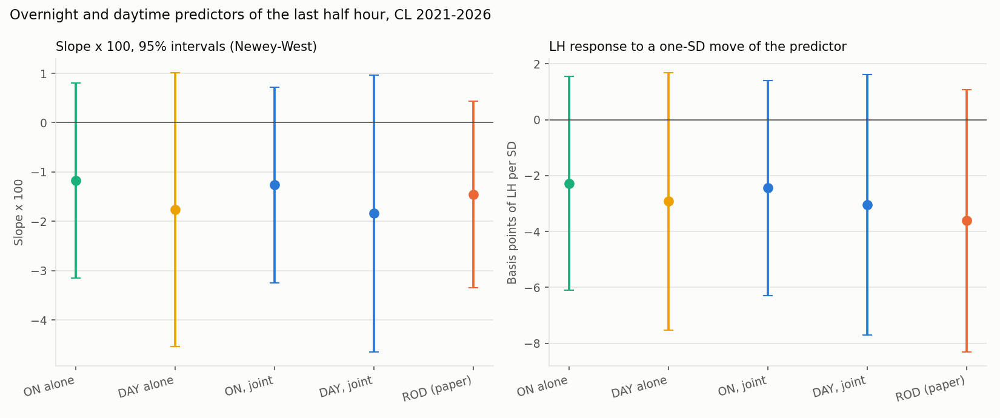
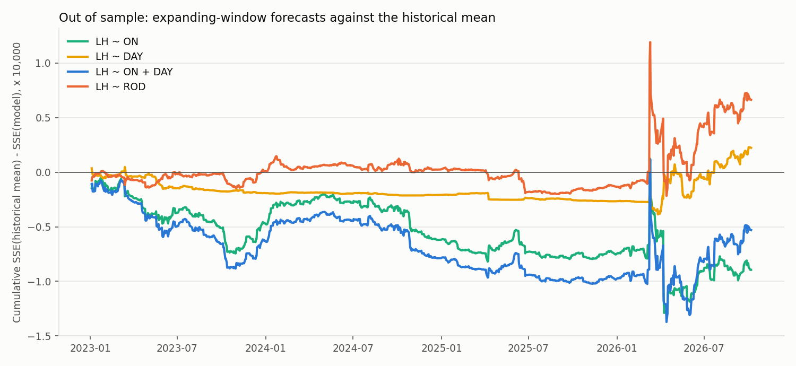
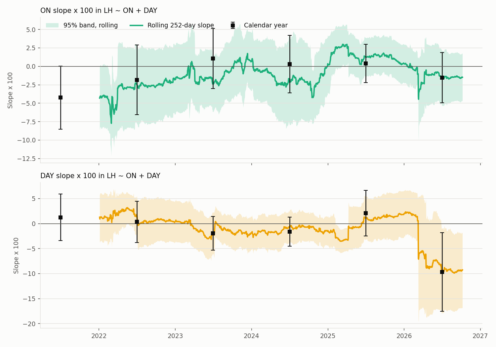

# Overnight versus Daytime Predictability of the Last Half Hour, CL 2021–2026 (#31)

This note reports the first new hypothesis: do the overnight (ON, previous 13:30 → 08:00 CT) and daytime (DAY, 08:00 → 13:00 CT) parts of the paper's rest-of-day return predict the last half hour (LH, 13:00 → 13:30 CT) differently? One script produces every number here:

```bash
python -m src.analyze_on_day --config config/on_day.yaml
python -m pytest tests/test_on_day.py
```

Tables are in `reports/tables/on_day_*.csv`, figures in `reports/figures/on_day_*.png`, and `analysis/08_on_day_results.ipynb` collects them. The final report, `reports/final_report.md`, Section 4.3, summarizes this note.

## Summary

- **Neither component predicts the close, and they do not predict differently.** In LH ~ ON + DAY the slopes × 100 are −1.26 (SE 1.01) for ON and −1.84 (1.43) for DAY, both slightly negative with intervals that include zero. Per standard deviation of the predictor the responses are −2.4 and −3.1 basis points of LH. The Wald test of equal slopes gives a difference of 0.58 (1.43), p = 0.69.
- **Splitting ROD into its parts adds nothing.** The joint model's adjusted R² (0.52%) equals the ROD model's (0.52%). Out of sample the joint model has an OOS R² of −0.29% against the historical mean, below the ROD model's 0.37%; DAY alone (0.12%) does better than ON alone (−0.50%), and adding DAY to ON raises the OOS R² by 0.20 percentage points (Clark-West p = 0.15) while adding ON to DAY lowers it by 0.42.
- **The slopes are unstable in sign over time and, as elsewhere in the project, lean on 2026.** Calendar-year DAY slopes range from +2.1 (2.3) in 2025 to −9.7 (4.0) in 2026, and ON slopes from −4.2 (2.2) in 2021 to +1.1 (2.1) in 2023. Without 10 March 2026 both full-sample slopes shrink to about −0.7 and the joint model's adjusted R² falls to zero.
- **Nothing depends on the conventions.** Log returns, the 3-sessions-before-expiry roll rule (127 days with a different contract) and Newey-West lags from 0 to 20 move no estimate by more than 0.1.

## Definitions and methods

| Item | Rule |
|---|---|
| Sample | The 1,436 trade dates of the return features (#28), 2021-01-04 to 2026-10-07 |
| Returns | Simple returns as in the paper: (1 + ON)(1 + DAY) = 1 + ROD. Standard deviations: ON 1.94%, DAY 1.66%, ROD 2.48%, LH 0.47%; the correlation of ON and DAY is −0.05. The log version, with log ON + log DAY = log ROD exactly, is a labeled robustness variant |
| Models | LH ~ ON, LH ~ DAY, LH ~ ON + DAY, and the paper's LH ~ ROD, each with an intercept |
| Inference | Newey-West standard errors, 7 lags (the automatic rule of #29), n/(n−k) correction; 95% intervals. Slopes × 100 and, for comparability across predictors with different spreads, the LH response in basis points to a one-standard-deviation move of the predictor |
| Equality | Wald test of β_ON = β_DAY in the joint model from the HAC covariance (df 1) |
| Incremental information | The joint model against each single-component model it nests: adjusted R² gain and the out-of-sample comparison of their expanding-window forecasts (Clark-West) |
| Out of sample | Expanding window after 500 observations (first forecast 2023-01-04, 936 forecasts) against the historical mean, as in #29; initial windows of 250 to 1,000 as sensitivity |
| Stability | Calendar-year estimates; 252-day rolling slopes of the joint model; the pre-expiry roll rule; excluded dates (roll, degraded, expiry-adjacent, after weekends and holidays, the 1% largest |ON| and |DAY| days, 10 March 2026) |

## Results

### Slopes (`on_day_regressions.csv`)

Slopes × 100 with Newey-West standard errors and 95% intervals; the last column is the LH response in basis points to a one-standard-deviation move of the predictor.

| Model | Term | Slope × 100 (SE) | 95% interval | t | Adj. R² (%) | Response per SD (bps) |
|---|---|---|---|---|---|---|
| LH ~ ON | ON | −1.18 (1.01) | [−3.15, 0.80] | −1.17 | 0.17 | −2.3 |
| LH ~ DAY | DAY | −1.76 (1.42) | [−4.53, 1.02] | −1.24 | 0.32 | −2.9 |
| LH ~ ON + DAY | ON | −1.26 (1.01) | [−3.25, 0.72] | −1.25 | 0.52 | −2.4 |
| | DAY | −1.84 (1.43) | [−4.64, 0.97] | −1.28 | | −3.1 |
| LH ~ ROD (paper) | ROD | −1.46 (0.97) | [−3.35, 0.43] | −1.51 | 0.52 | −3.6 |



The two components have almost the same slope and the same sign; the joint model's slopes are within 0.1 of the single-model ones because ON and DAY are nearly uncorrelated. The ROD slope is a weighted average of the two and is the most precisely estimated, since ROD has the largest spread.

| Test | Value |
|---|---|
| β_ON − β_DAY (SE) | 0.58 (1.43) |
| Wald statistic (df 1), p | 0.16, 0.69 |

### Incremental information and out of sample (`on_day_models.csv`, `on_day_oos_sensitivity.csv`)

936 expanding-window forecasts from 2023-01-04. OOS R² in percent against the historical mean; the nested comparisons are the joint model against each single model's own forecasts.

| Model | Adj. R² (%) | OOS R² vs mean (%) | Clark-West p | vs LH ~ ON | vs LH ~ DAY |
|---|---|---|---|---|---|
| LH ~ ON | 0.17 | −0.50 | 0.54 | | |
| LH ~ DAY | 0.32 | 0.12 | 0.22 | | |
| LH ~ ON + DAY | 0.52 | −0.29 | 0.37 | +0.20 (p = 0.15) | −0.42 (p = 0.48) |
| LH ~ ROD | 0.52 | 0.37 | 0.16 | | |



The daytime return is the more useful of the two components out of sample, and the overnight return subtracts from it: the joint model forecasts worse than DAY alone. None of the four models beats the historical mean at conventional levels, and the ordering changes with the first forecast date (`on_day_oos_sensitivity.csv`: from 2024 on, the joint model's OOS R² is +0.08%, from 2025 on +0.23%, still below ROD's 0.49% and 0.58%). The ROD model's small out-of-sample advantage is the #29 result and depends on 10 March 2026.

### Over time (`on_day_by_year.csv`, `on_day_rolling.csv`)



Calendar-year slopes × 100 in LH ~ ON + DAY:

| Year | ON (SE) | DAY (SE) |
|---|---|---|
| 2021 | −4.23 (2.18) | 1.26 (2.37) |
| 2022 | −1.83 (2.41) | 0.34 (2.11) |
| 2023 | 1.06 (2.09) | −1.92 (1.71) |
| 2024 | 0.29 (1.99) | −1.61 (1.49) |
| 2025 | 0.39 (1.33) | 2.08 (2.34) |
| 2026 (to Oct 7) | −1.54 (1.74) | −9.65 (4.00) |

The ON slope was most negative in 2021–2022 and near zero afterwards; the DAY slope was near zero until 2025 and strongly negative in 2026, where it is the only calendar-year estimate whose interval excludes zero. The rolling 252-day bands exclude zero in 60 of 1,185 windows for ON and 116 for DAY, mostly windows ending in early 2022 (ON) and after March 2026 (DAY); among this many overlapping windows, runs of that length are expected under no effect.

### Robustness (`on_day_robustness.csv`, `on_day_robustness_models.csv`)

Joint-model slopes × 100 (SE) under each variant.

| Variant | Days | ON | DAY | Equality p | Adj. R² (%) |
|---|---|---|---|---|---|
| Baseline, 7 Newey-West lags | 1,436 | −1.26 (1.01) | −1.84 (1.43) | 0.69 | 0.52 |
| Newey-West lags 0 / 1 / 5 / 10 / 20 | 1,436 | SE 1.02 / 1.06 / 1.06 / 0.96 / 0.91 | SE 1.51 / 1.52 / 1.45 / 1.43 / 1.45 | 0.69–0.70 | 0.52 |
| Log returns | 1,436 | −1.22 (1.03) | −1.85 (1.45) | 0.66 | 0.52 |
| Roll 3 sessions before expiry | 1,436 | −1.29 (1.01) | −1.88 (1.44) | 0.68 | 0.55 |
| Without roll dates | 1,367 | −0.87 (1.04) | −2.00 (1.46) | 0.43 | 0.47 |
| Without degraded dates | 1,424 | −1.37 (1.02) | −1.91 (1.44) | 0.70 | 0.60 |
| Without the last 3 sessions before expiry | 1,309 | −1.35 (1.04) | −1.74 (1.55) | 0.79 | 0.50 |
| Without days after a weekend or holiday | 1,132 | −0.98 (1.19) | −1.73 (1.81) | 0.65 | 0.31 |
| Without the 1% largest \|ON\| days | 1,421 | −1.71 (1.13) | −1.92 (1.44) | 0.88 | 0.69 |
| Without the 1% largest \|DAY\| days | 1,421 | −0.23 (0.86) | −1.33 (0.85) | 0.36 | 0.07 |
| Without 10 March 2026 | 1,435 | −0.73 (0.89) | −0.63 (0.93) | 0.93 | 0.00 |

The conventions do not matter. The extreme days do: dropping the 15 largest daytime moves or the single day 10 March 2026 removes most of what little fit there is, the same pattern as in the replication (#29). Out-of-sample statistics are reported for the variants whose exclusions are known in advance (`on_day_robustness_models.csv`); for the two quantile-based exclusions they are omitted, because the dates are chosen with a full-sample threshold and forecasts on the remaining dates would not be prospective.

## Interpretation

The paper's hedging-demand story does not distinguish the overnight and daytime legs of the day's move: a hedger who is short gamma must trade in the direction of the full move from the previous close. In post-2020 CL neither leg predicts the close, so there is nothing for the decomposition to split. The daytime leg is the one that carries the little information there is, and it carries it in the reversal direction, mostly in 2026. The sign-agreement analysis (#33) takes this further: what matters is not which leg moved but whether the two legs moved the same way.

## Checks

- Tests cover the column mapping, recovery of a planted daytime-only effect with the equality test and both nested out-of-sample comparisons, the standardized slope as coefficient × sd(predictor) / sd(target), the exact additivity of the log decomposition, and the configuration checks for unknown predictors and non-nested pairs.
- The baseline ROD row reproduces the #29 estimate (−1.46 (0.97), OOS R² 0.37%) exactly, since both scripts use the same functions and data.
- 87 tests pass (`python -m pytest`), 5 of them for this module.
