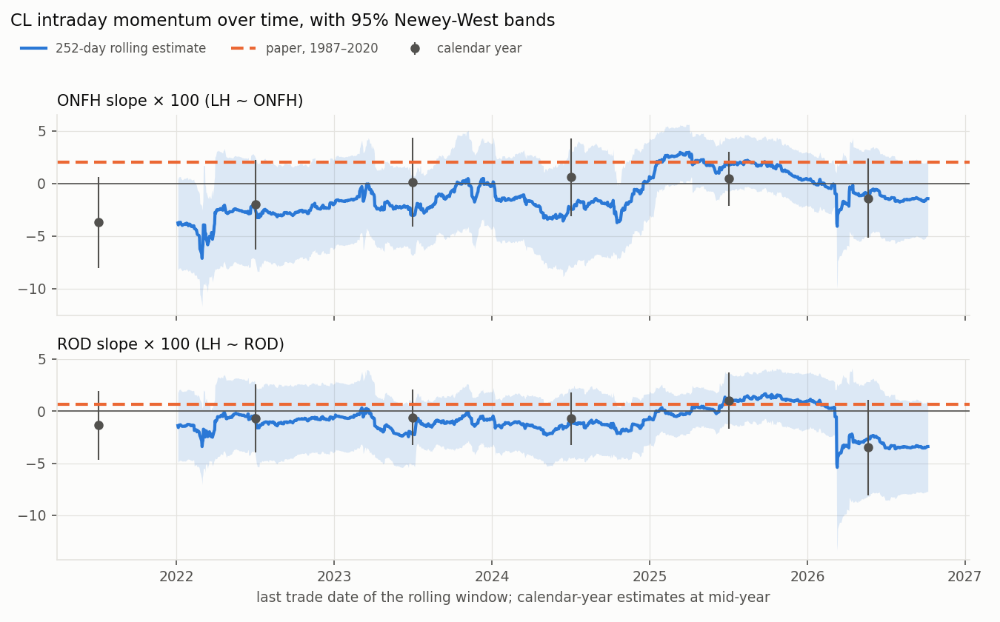
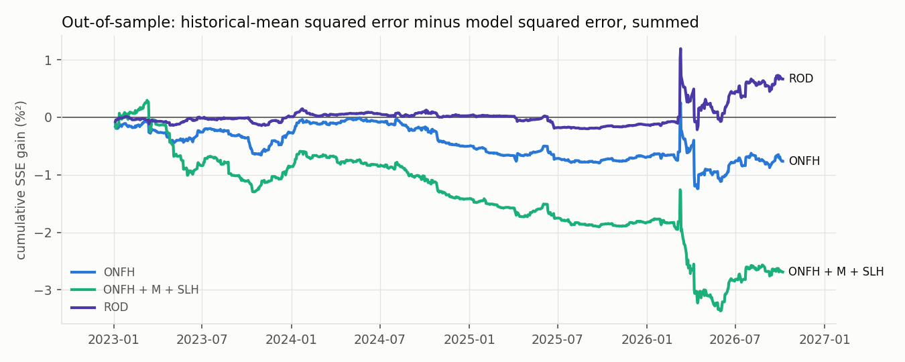

# Replication Results: CL Intraday Momentum, 2021–2026 (#29)

This note reports our replication of the crude oil (CL) results in Baltussen, Da, Lammers & Martens (2021), *Hedging Demand and Market Intraday Momentum*, on 2021–2026 data. It is a draft of the replication section of the final report. All numbers come from `python -m src.replicate_regressions --config config/replication.yaml`. The tables are in `reports/tables/replication_*.csv` and the figures in `reports/figures/replication_*.png`.

## What is being tested

The paper asks whether the return earned during the trading day predicts the return in the **last half hour before the close**. For CL the paper uses an 08:00–13:30 CT trading window (09:00–14:30 ET), so the target is the return from 13:00 to 13:30 CT on day t:

- **LH** (target) = P(t, 13:30) / P(t, 13:00) − 1

The predictors use only prices up to 13:00 CT on day t, so a trader could act on them at 13:00. Each predictor starts at a reference price; P(t−1, 13:30) is the previous trade date's 13:30 price.

| Predictor | Interval (CT) | Meaning |
|---|---|---|
| ONFH | previous 13:30 → 08:30 | overnight plus the first half hour |
| M | 08:30 → 12:30 | middle of the day |
| SLH | 12:30 → 13:00 | second-to-last half hour |
| ROD | previous 13:30 → 13:00 | the whole "rest of the day" before the last half hour (ONFH, M and SLH compounded) |

We estimate the paper's three linear models, each with an intercept α:

1. LH = α + β·ONFH + ε (paper Eq. 5)
2. LH = α + β₁·ONFH + β₂·M + β₃·SLH + ε (Eq. 6)
3. LH = α + β·ROD + ε (Eq. 7)

A positive β means **intraday momentum**: a rise during the day tends to continue into the close. A negative β means **reversal**.

The quantity of interest is each slope β, which we report with its standard error and 95% confidence interval. As in the paper, slopes are multiplied by 100. For example, a ROD slope × 100 of 1.0 means that a 1% rest-of-day return predicts a 0.01% last-half-hour return. LH has a daily standard deviation of only 0.47%, against 2.48% for ROD, so slopes are small even when the effect is economically meaningful.

**Sample.** We use 1,436 CME trade dates from 4 January 2021 to 7 October 2026, from Databento 1-minute bars (#25–#28). Every price on day t comes from the contract held on t, so no return crosses a contract roll. We apply the paper's filters: no early-close days and no days with volume under 100 contracts. The paper's CL sample has 8,336 days, from 1987 to May 2020 (Appendix Table B3).

**Inference.** We use Newey-West standard errors with 7 lags, the usual automatic choice of ⌊4(n/100)^(2/9)⌋. The paper uses Newey-West for individual contracts but does not state its lag length. The paper reports t-statistics rather than standard errors, so we recover its standard errors as |β / t|.

**Out-of-sample test.** For each day after the first 500 observations (forecasts start on 4 January 2023, 936 forecasts), we fit the model on all earlier days and forecast LH. We compare these forecasts with the historical mean of LH up to the previous day:

- **OOS R²** = 1 − Σ(LH − forecast)² / Σ(LH − historical mean)². It is positive when the model forecasts better than the historical mean (paper Eq. 8).
- **Clark-West statistic**: tests whether the model's mean squared error is significantly below the benchmark's (Eq. 9).

## Results

### Full-sample estimates against the paper

Slopes × 100, with 95% confidence intervals in brackets. Adjusted R² and OOS R² are in percent.

| Model | Slope | Paper, 1987–2020 | Ours, 2021–2026 | Ours − paper (SE) |
|---|---|---|---|---|
| ONFH | ONFH | 2.00 [−3.44, 7.44] | **−1.30** [−3.16, 0.57] | −3.30 (2.94) |
| ONFH + M + SLH | ONFH | 2.40 [−1.80, 6.60] | **−1.32** [−3.15, 0.51] | −3.72 (2.34) |
| | M | −0.06 [−3.98, 3.86] | **−1.94** [−5.58, 1.70] | −1.88 (2.73) |
| | SLH | −13.95 [−41.57, 13.67] | **0.38** [−9.33, 10.09] | 14.33 (14.94) |
| ROD | ROD | 0.67 [−4.58, 5.92] | **−1.46** [−3.35, 0.43] | −2.13 (2.85) |

| Model | Adj. R², paper | Adj. R², ours | OOS R², paper | OOS R², ours | Clark-West t, ours (one-sided p) |
|---|---|---|---|---|---|
| ONFH | 0.17 | 0.24 | −0.48 | −0.42 | 0.12 (0.45) |
| ONFH + M + SLH | 1.25 | 0.46 | −1.77 | −1.49 | −0.99 (0.84) |
| ROD | 0.03 | 0.52 | −1.04 | 0.37 | 1.00 (0.16) |


- **No intraday momentum in CL after 2020.** Every 95% interval contains zero. The point estimates for ONFH, M and ROD are negative, the opposite sign to the paper's, which points to mild reversal rather than momentum. For ROD, the estimate of −1.46 means that a 1% rest-of-day return predicts a −0.015% last-half-hour return. The 95% interval runs from −0.034% to +0.004%.
- **The data cannot tell the two periods apart.** Each difference between our slope and the paper's is at most 1.6 standard errors (treating the samples as independent). This is consistent with the paper, whose CL slopes were not significant either (ROD t = 0.25).
- **Our estimates are about three times as precise as the paper's**, although we have one sixth of its observations: the ROD standard error is 0.97 here and 2.68 in the paper. One possible cause, which we cannot verify, is a few extreme observations in the paper's sample. That sample ends on 1 May 2020, just after the April 2020 episode when the front CL contract traded near and below zero, where simple returns become very large. That would also explain the paper's adjusted R² of 1.25% in Model 2, despite all three t-statistics being below 1.2.

### Over time



The figure shows 252-day rolling estimates with 95% bands, calendar-year estimates, and the paper's point estimate.

- **ROD.** The slope was negative in every calendar year except 2025 (+1.02, interval [−1.65, 3.70]), and no single year excludes zero.
- **2026.** The rolling ROD slope dropped sharply in March 2026, when daily ROD moves reached ±15%. The 2026 estimate is −3.49 [−8.10, 1.11].
- **ONFH.** The rolling ONFH estimate follows the same pattern. It is above the paper's 2.00 only in windows ending in 2025, peaking at 2.95. Its band excludes zero in 54 of 1,185 windows: below zero for windows ending in February–March 2022 and October 2024, and above zero for windows ending in March–April 2025. Among this many overlapping windows, a few short runs outside zero are to be expected. The rolling ROD band excludes zero in only 2 windows, both ending in March 2022.

### Out of sample



The figure plots the running sum of (historical-mean squared error − model squared error). A rising line means the model is beating the historical mean.

- **ONFH and ONFH + M + SLH** lose to the historical mean (OOS R² −0.42% and −1.49%), as they did in the paper (−0.48% and −1.77%).
- **ROD** ends with a small positive OOS R² of 0.37%, but the Clark-West test does not reject the historical mean (t = 1.00, one-sided p = 0.16). The gain is concentrated in March 2026. A single day, 10 March 2026, contributes most of it: ROD was −15.4% and LH +4.6%, a reversal that the negative slope forecast correctly in sign. Without March 2026 the OOS R² is 0.20%.
- **First forecast date.** The ROD OOS R² depends on when forecasting starts: −0.02% from 2022, 0.37% from 2023, 0.49% from 2024 and 0.58% from 2025. The Clark-West p-value is between 0.16 and 0.28 in every case (`replication_oos_sensitivity.csv`).

### Robustness

Each row re-estimates the ROD model (slope × 100, standard error in parentheses). All variants are in `replication_robustness.csv`.

| Variant | Days | ROD slope | OOS R² (%) |
|---|---|---|---|
| Baseline (7 Newey-West lags) | 1,436 | −1.46 (0.97) | 0.37 |
| Newey-West lags 0 / 1 / 5 / 10 / 20 | 1,436 | −1.46 (1.01 / 1.03 / 0.98 / 0.93 / 0.89) | — |
| Roll 3 sessions before expiry (existing rule) | 1,436 | −1.49 (0.96) | 0.40 |
| Without roll dates | 1,367 | −1.29 (1.00) | 0.11 |
| Without Databento degraded dates | 1,424 | −1.55 (0.98) | 0.51 |
| Without the last 3 sessions before expiry | 1,309 | −1.46 (1.02) | 0.34 |
| Without days after a weekend or holiday | 1,132 | −1.25 (1.23) | −0.32 |
| Without the 1% largest absolute ROD days | 1,421 | −0.76 (0.66) | 0.14 |

- **The sign does not change.** The negative slope holds under every lag length, both roll rules, and every exclusion.
- **The roll rule barely matters.** Holding the next contract 1–2 sessions earlier, as the existing pre-expiry rule does, changes the contract on 127 days but moves the ROD slope by only 0.03.
- **Extreme days matter most.** Dropping the 15 days with the largest ROD moves (8 in March–April 2026, 5 in March and July 2022, 1 in June 2025 and 1 in July 2026) halves the slope, to −0.76. This shows that the negative estimate is driven partly by reversals on crisis days.

## Differences from the paper

| Item | Paper (CL) | This replication |
|---|---|---|
| Period, observations | 1987-01-06 to 2020-05-01, 8,336 days | 2021-01-04 to 2026-10-07, 1,436 days |
| Data | Tick Data intraday prices | Databento `GLBX.MDP3` 1-minute bars, full Globex session |
| Trading window | 09:00–14:30 ET | 08:00–13:30 CT (the same clock times) |
| Price at time T | not stated | Close of the last 1-minute bar starting before T; at most 5 minutes stale (never needed) |
| Contract and roll | most liquid contract; roll when the next contract's daily tick volume exceeds it | the same rule, using contract volume over the 17:00–16:00 CT session; the roll takes effect at the next open |
| Sample filters | non-positive prices, non-business days, early closes, volume < 100 | the same; 12 days excluded, all early closes or the day after one |
| Standard errors | Newey-West, lag length not stated | Newey-West, 7 lags, n/(n−k) correction; 0–20 lags as robustness |
| Out of sample | expanding window, at least 500 observations | the same; first forecast 2023-01-04 |
| Reported uncertainty | t-statistics | standard errors and 95% intervals; the paper's standard errors are implied from its β and t, so they inherit its rounding |

## Conclusion

In 2021–2026 we find **no evidence of intraday momentum in CL**. The slopes are small and slightly negative, every confidence interval includes zero, and only the ROD model beats the historical mean out of sample. That small gain is not statistically distinguishable from zero and comes mostly from March 2026. This agrees with the paper's own CL result, which was not significant either. In the new hypotheses (#31–#33), the questions are therefore whether the overnight and daytime parts of ROD predict differently, and whether the reversal seen on extreme days is a volatility-regime effect (#32), rather than whether CL momentum exists.

## Reproducing

```bash
python -m src.build_return_features --config config/return_features.yaml   # #28
python -m src.replicate_regressions --config config/replication.yaml       # #29
python -m pytest
```

Settings, including the paper's Table B3 values used for the comparison, are in `config/replication.yaml`. `reports/tables/replication.manifest.json` records the input and output hashes.
