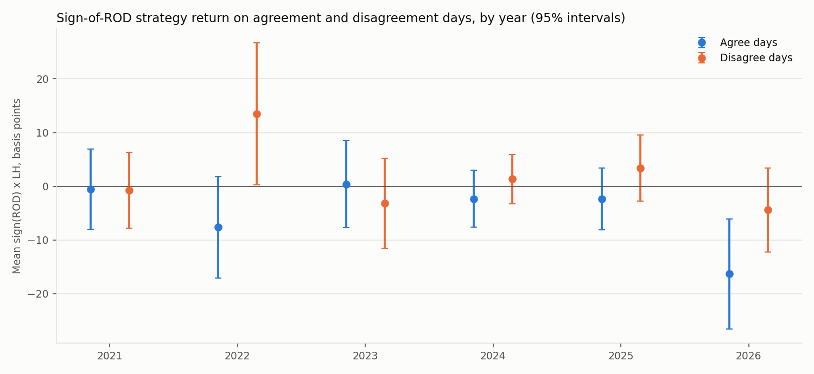
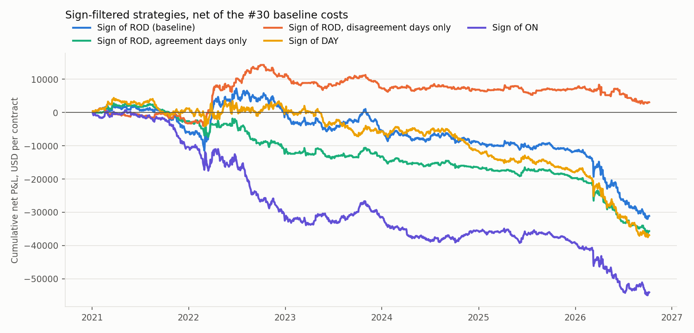

# Overnight/Daytime Sign Agreement and Last-Half-Hour Momentum, CL 2021–2026 (#33)

This note reports the third new hypothesis: does agreement or disagreement between the overnight (ON, previous 13:30 → 08:00 CT) and daytime (DAY, 08:00 → 13:00 CT) return directions change the last-half-hour (LH, 13:00 → 13:30 CT) momentum that the paper's rest-of-day predictor is meant to capture? Following the instructor's check-in note, coherence is treated both as four sign categories and as the two-dimensional vector (ON, DAY). One script produces every number here:

```bash
python -m src.analyze_sign_agreement --config config/sign_agreement.yaml
python -m pytest tests/test_sign_agreement.py
```

Tables are in `reports/tables/sign_agreement_*.csv`, figures in `reports/figures/sign_agreement_*.png`, and `analysis/07_sign_agreement_results.ipynb` collects them. The final project report, `reports/final_report.md`, places this result next to the replication (#29), the strategy backtest (#30) and the volatility regimes (#32).

## Summary

- **When ON and DAY agree, the last half hour reverses rather than continues.** On the 720 agreement days the paper's sign-of-ROD strategy earns −4.5 basis points per day (standard error 1.7); on the 704 disagreement days it earns +1.9 (1.8). The difference, −6.4 (2.3), has p = 0.007, below the Bonferroni level of 0.010 for the five pre-registered comparisons. In the regression LH ~ ROD + Agree + ROD×Agree the interaction slope × 100 is −5.0 (1.6): the ROD slope is +2.4 (1.2) on disagreement days and −2.6 on agreement days. The hypothesis in the project plan was that agreement would strengthen momentum; the data say the opposite.
- **The two-dimensional view says the same thing without a threshold.** The product ON×DAY enters LH ~ ON + DAY + ON×DAY with slope × 100 of 108 (47): the more both components move the same way, the more the close moves back. On the tercile grid the two agreement corners are the most negative strategy cells (ON high/DAY high −5.6 basis points of LH, ON low/DAY low +6.9), and the mean LH along the anti-diagonal is close to zero.
- **Out of sample the agreement term helps, but only just.** Adding Agree and ROD×Agree to the paper's ROD model raises the expanding-window OOS R² from 0.37% to 0.75% against the historical mean (Clark-West p = 0.05) and gives 0.38% against the ROD model it nests (p = 0.06). The ON×DAY product does not improve the ON + DAY forecasts (−0.31%).
- **It is a 2022 and 2026 result.** The agree-minus-disagree difference is −21 (8) basis points in 2022 and −12 (7) in 2026, and within ±6 of zero in the other years; the agreement-day loss in 2026 is −16 (5). Both are high-volatility years, which links this result to the volatility finding in #32, where agreement was not separated out.
- **No sign filter makes the strategy profitable after costs.** Trading the sign of ROD only on disagreement days gives a net mean of −0.1 (0.8) basis points and USD +3,055 over the sample, against −3.1 (1.3) and −USD 31,095 for the unfiltered baseline; agreement-days-only gives −3.2 (0.9). A disagreement filter removes the losses but does not create a profit, and it is chosen with hindsight.

## Definitions and methods

| Item | Rule |
|---|---|
| Sample | The 1,436 trade dates of the return features (#28), 2021-01-04 to 2026-10-07. 12 dates with ON or DAY exactly zero are reported separately and left out of the four groups |
| Categories | ON+/DAY+ (415 days), ON−/DAY− (305), ON+/DAY− (377), ON−/DAY+ (327). The first two are agreement, the other two disagreement; both signs are known at 13:00 CT |
| Group statistics | Mean LH, the paper's strategy return η = sign(ROD)·LH, and the share of days on which LH has the sign of ROD, each with a Newey-West standard error (7 lags, the rule of #29). The agree-minus-disagree difference is the slope of η on the agreement indicator with HAC standard errors |
| Two-dimensional view | ON and DAY cut into terciles; mean LH, its standard error and η per cell. Regressions LH ~ ON + DAY + ON×DAY (the product is the scalar coherence of the vector), LH ~ ROD + Agree + ROD×Agree, and LH ~ ON + DAY + Agree + ON×Agree + DAY×Agree, with a Wald test of the interaction terms |
| Out of sample | Expanding-window forecasts after 500 observations (936 forecasts from 2023-01-04), against the historical mean and against the nested model, with the Clark-West test, as in #29 |
| Trading | Sign-of-ROD positions on all days, on agreement days only, on disagreement days only, plus sign-of-DAY and sign-of-ON, priced with the #30 fills and costs (first trade at or after 13:00 and 13:30 CT, USD 2.50 commission and 0.5 tick per side) |
| Multiple testing | Five pre-registered comparisons (the agree-minus-disagree difference, ROD×Agree, ON×DAY, ON×Agree, DAY×Agree); the Bonferroni level is 0.010 |

## Results

### Sign categories (`sign_agreement_categories.csv`)

Mean LH and the strategy return η = sign(ROD)·LH in basis points with Newey-West standard errors; the hit rate is the share of days on which LH has the sign of ROD.

| Group | n | Mean LH (SE) | η = sign(ROD)·LH (SE) | 95% interval for η | LH follows ROD |
|---|---|---|---|---|---|
| ON+/DAY+ | 415 | −4.11 (1.90) | −4.11 (1.90) | [−7.8, −0.4] | 0.470 |
| ON−/DAY− | 305 | 4.99 (3.06) | −5.00 (3.06) | [−11.0, 1.0] | 0.469 |
| ON+/DAY− | 377 | −3.69 (2.29) | 2.10 (2.32) | [−2.5, 6.7] | 0.509 |
| ON−/DAY+ | 327 | −1.07 (2.48) | 1.62 (2.43) | [−3.1, 6.4] | 0.462 |
| Agreement | 720 | −0.25 (1.57) | −4.48 (1.71) | [−7.8, −1.1] | 0.469 |
| Disagreement | 704 | −2.47 (1.62) | 1.88 (1.82) | [−1.7, 5.4] | 0.487 |
| Agreement − disagreement | 1,424 | | −6.36 (2.34), p = 0.007 | [−11.0, −1.8] | −0.018 |


On agreement days the close moves against the day: ON+/DAY+ days end with a negative last half hour and ON−/DAY− days with a positive one. On disagreement days the mean LH is negative in both cells, so it carries no information about the sign of ROD, and the strategy return is small and positive. The hit rates stay near one half everywhere (0.47 on agreement days, 0.49 on disagreement days); the difference is in the size of the moves, not their frequency.

### The two-dimensional view (`sign_agreement_grid.csv`)


Mean LH in basis points on the ON × DAY tercile grid (standard errors 2.6 to 5.0, 147 to 170 dates per cell). The agreement corners carry the reversal: ON high/DAY high −5.6, ON low/DAY low +6.9, and the mid/high and high/low cells next to them −7.1 and −8.2. The middle row and column are close to zero. The product regression summarizes the grid in one number:

| Model | Term | Slope × 100 (SE) | 95% interval | p | Adj. R² (%) | Wald p (interactions) |
|---|---|---|---|---|---|---|
| LH ~ ROD | ROD | −1.46 (0.97) | [−3.3, 0.4] | 0.13 | 0.52 | |
| LH ~ ROD + Agree + ROD×Agree | ROD | 2.36 (1.23) | [−0.1, 4.8] | 0.055 | 1.71 | 0.002 |
| | ROD×Agree | −5.00 (1.60) | [−8.1, −1.9] | 0.002 | | |
| LH ~ ON + DAY | ON | −1.26 (1.01) | [−3.2, 0.7] | 0.21 | 0.52 | |
| | DAY | −1.84 (1.43) | [−4.6, 1.0] | 0.20 | | |
| LH ~ ON + DAY + ON×DAY | ON×DAY | 108 (47) | [16, 200] | 0.021 | 1.88 | 0.021 |
| LH ~ ON + DAY + Agree + ON×Agree + DAY×Agree | ON×Agree | −1.19 (2.08) | [−5.3, 2.9] | 0.57 | 2.47 | 0.004 |
| | DAY×Agree | −10.06 (3.43) | [−16.8, −3.3] | 0.003 | | |

The agreement effect sits in the daytime leg: on agreement days the DAY slope moves from +3.6 to −6.5, while the ON slope hardly changes. A 1% daytime move that agrees with the overnight direction is followed by a 0.065% reversal in the last half hour on average.

### Out of sample (`sign_agreement_oos.csv`)

936 expanding-window forecasts from 2023-01-04. OOS R² in percent.

| Model | vs historical mean | Clark-West p | vs nested model | Clark-West p |
|---|---|---|---|---|
| LH ~ ROD | 0.37 | 0.16 | | |
| LH ~ ROD + Agree + ROD×Agree | 0.75 | 0.052 | 0.38 (vs ROD) | 0.056 |
| LH ~ ON + DAY | −0.29 | 0.37 | | |
| LH ~ ON + DAY + ON×DAY | −0.60 | 0.28 | −0.31 (vs ON + DAY) | 0.24 |
| LH ~ ON + DAY + Agree + ON×Agree + DAY×Agree | −0.19 | 0.14 | 0.11 (vs ON + DAY) | 0.10 |

The agreement interaction is the only addition in the project that improves forecasts out of sample, and the improvement is at the edge of significance. The product term fits better in sample but not out of it.

### Stability (`sign_agreement_by_year.csv`)



| Year | Agreement η (SE) | Disagreement η (SE) | Difference (SE) |
|---|---|---|---|
| 2021 | −0.6 (3.8) | −0.7 (3.6) | 0.2 (5.3) |
| 2022 | −7.6 (4.8) | 13.5 (6.7) | −21.1 (7.7) |
| 2023 | 0.4 (4.1) | −3.2 (4.3) | 3.6 (5.0) |
| 2024 | −2.3 (2.7) | 1.3 (2.4) | −3.7 (3.3) |
| 2025 | −2.3 (2.9) | 3.4 (3.1) | −5.7 (4.6) |
| 2026 (to Oct 7) | −16.3 (5.2) | −4.4 (4.0) | −11.9 (6.9) |

The sign of the difference is negative in four of six years, but the magnitude comes from 2022 and 2026. Both were high-volatility years (#32), and in both the agreement days are the days on which oil moved a lot in one direction before the close.

### Trading comparison (`sign_agreement_strategies.csv`)

Net of the #30 baseline costs (USD 15 per round trip). Means over all 1,436 dates, days without a position counting as zero.

| Strategy | Traded days | Net mean (SE) | Sharpe (SE) | Hit rate | Net P&L | Gross P&L |
|---|---|---|---|---|---|---|
| Sign of ROD (baseline, #30) | 1,435 | −3.15 (1.26) | −1.07 (0.42) | 0.466 | −31,095 | −9,570 |
| Sign of ROD, agreement days only | 720 | −3.19 (0.87) | −1.44 (0.42) | 0.457 | −35,650 | −24,850 |
| Sign of ROD, disagreement days only | 703 | −0.08 (0.84) | −0.04 (0.42) | 0.471 | 3,055 | 13,600 |
| Sign of DAY | 1,432 | −3.41 (1.14) | −1.15 (0.42) | 0.468 | −36,870 | −15,390 |
| Sign of ON | 1,428 | −4.82 (1.26) | −1.64 (0.42) | 0.463 | −54,050 | −32,630 |



The baseline's losses come entirely from agreement days. Skipping them leaves a strategy that is flat after costs (USD +3,055 over almost six years, interval well around zero). The filter is a hindsight choice: it was selected because the agreement result was found in the same sample, so the number is a description of the past rather than a forecast.

### Robustness (`sign_agreement_robustness.csv`, `sign_agreement_robustness_regressions.csv`)

Agree-minus-disagree difference in η and the two main interaction slopes (× 100), with standard errors.

| Variant | Difference (SE) | p | ROD×Agree (SE) | DAY×Agree (SE) |
|---|---|---|---|---|
| Baseline | −6.36 (2.34) | 0.007 | −5.00 (1.60) | −10.06 (3.43) |
| Without 10 March 2026 | −5.74 (2.27) | 0.011 | −4.00 (1.38) | −7.57 (2.49) |
| Without roll dates | −7.18 (2.37) | 0.002 | −5.41 (1.61) | −10.98 (3.51) |
| Without degraded dates | −6.89 (2.38) | 0.004 | −5.18 (1.63) | −9.96 (3.42) |
| Without sessions after a weekend or holiday | −6.74 (2.69) | 0.012 | −6.19 (1.84) | −11.34 (4.08) |
| Log returns | −6.36 (2.34) | 0.007 | −5.08 (1.61) | −10.13 (3.43) |

The result does not depend on a single day or on the roll convention. Without 10 March 2026 the ON×DAY product slope falls from 108 (47) to 46 (38), so the continuous version does lean on that day; the categorical version does not.

## Interpretation and caveats

- **Direction.** The hedging-demand story of the paper predicts stronger momentum when the day's move is unambiguous. On CL after 2020 the opposite holds: unambiguous days reverse into the close. One reading is that in a market dominated by two crises (2022 and 2026), large one-directional days attract profit-taking or inventory unwinding before the 13:30 reference close rather than hedging flows in the direction of the move.
- **Statistical weight.** One of five pre-registered comparisons clears the Bonferroni level in sample, and the out-of-sample Clark-West test is at p ≈ 0.05. This is evidence worth reporting, not a settled fact.
- **Overlap with #32.** High-volatility days and agreement days overlap in 2022 and 2026. The volatility interactions alone were not significant (#32); the sign interaction is. A joint model is a natural follow-up and is not attempted here to avoid stacking tests.
- **Trading.** No version of the strategy earns a positive net return with a confidence interval that excludes zero.

## Checks

- Tests cover the classification and the zero-return days, the strategy return and hit rate, the group means and the agree-minus-disagree difference on a constructed sample, the grid's partition of the dates, recovery of a planted agreement effect with its Wald test and nested OOS comparison, and the sign-filtered positions. Every sign is from a 13:00 CT price.
- The trading comparison reuses the #30 functions, so the baseline row reproduces the #30 net result exactly (−3.15 bps, −USD 31,095).
- 70 tests pass (`python -m pytest`), 6 of them for this module.
