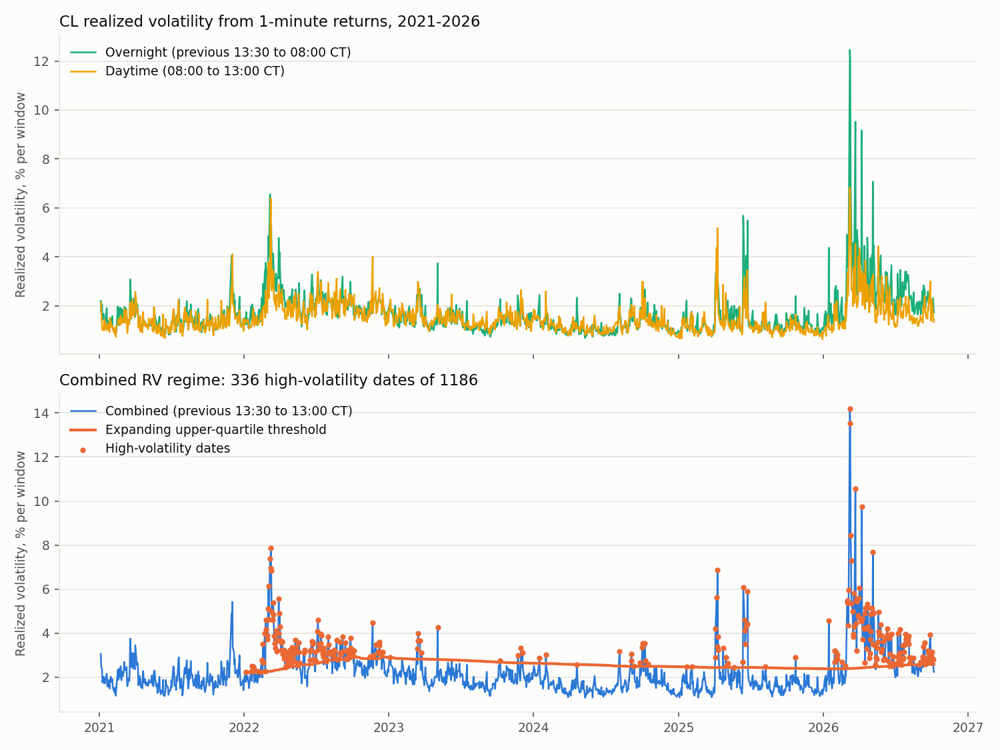
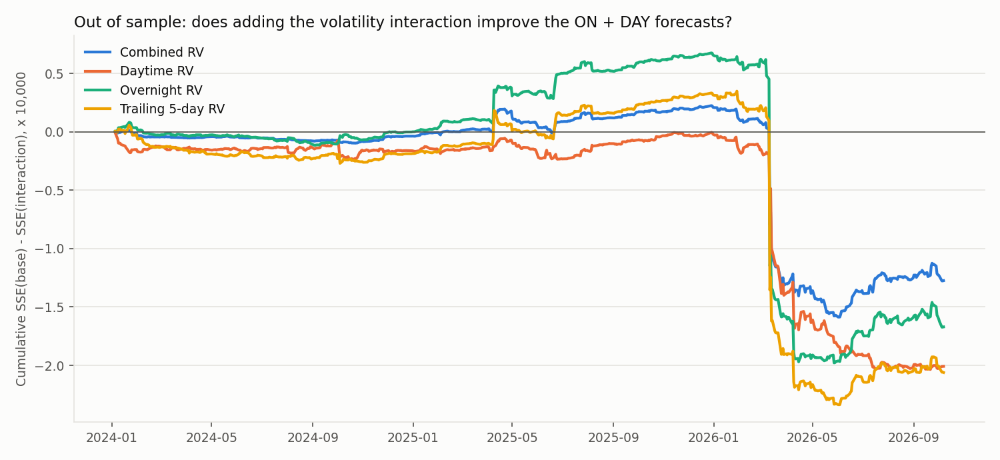
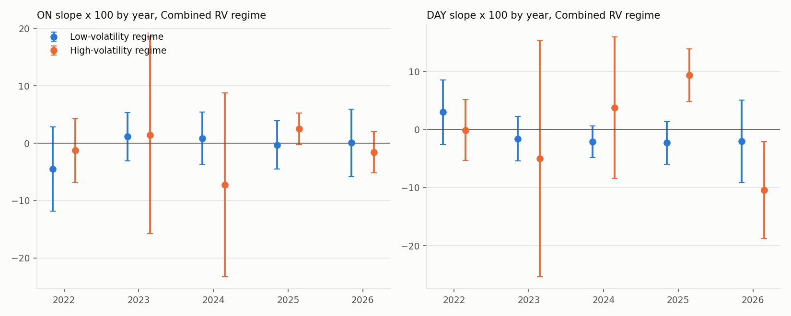

# Volatility Regimes and Overnight/Daytime Predictability, CL 2021–2026 (#32)

This note reports the second new hypothesis: does the predictive power of the overnight (ON) and daytime (DAY) returns for the last half hour (LH) change in high-volatility regimes? Volatility is measured from 1-minute returns and is known at the 13:00 CT decision time. Two scripts produce every number here:

```bash
python -m src.build_volatility_features --config config/volatility_features.yaml    # realized variance per trade date
python -m src.analyze_volatility_regimes --config config/volatility_regimes.yaml    # regime interactions, OOS, robustness
python -m pytest tests/test_volatility_regimes.py
```

The feature table is `data/processed/cl_volatility_features.parquet` (documented in `data/README.md`). Tables are in `reports/tables/volatility_regimes_*.csv`, figures in `reports/figures/volatility_regimes_*.png`, and `analysis/06_volatility_regimes_results.ipynb` collects them. The ON + DAY model used as the base here is the #31 specification; its full treatment is in #31.

## Summary

- **High-volatility regimes do not change the ON or DAY slopes by a measurable amount.** With the combined realized variance (previous 13:30 to 13:00 CT) defining the regime, the ON slope × 100 is −0.33 (SE 1.13) in low-volatility regimes and −1.30 (1.46) in high ones; the DAY slope is −1.29 (0.97) against −3.07 (2.71). The differences, −0.97 (1.84) and −1.79 (2.94), have p-values of 0.60 and 0.54, and the joint Wald test of both interactions has p = 0.78. The daytime, overnight and trailing 5-day variance regimes give the same picture: none of the eight interaction p-values is below 0.41, against a Bonferroni level of 0.006.
- **The point estimates lean towards stronger reversal in high volatility, but one day carries most of it.** Without 10 March 2026 the high-regime ON and DAY slopes move to −0.40 (1.22) and −0.59 (1.75), and the differences from the low regime shrink to −0.07 and +0.70.
- **Out of sample the interaction models forecast worse than the base model.** Over 686 forecasts from 5 January 2024, LH ~ ON + DAY has an OOS R² of 0.35% against the historical mean (Clark-West p = 0.18); adding the regime terms gives −0.61% to −1.19% depending on the regime measure, and −0.95% to −1.54% relative to the base model's own forecasts. The loss is concentrated in March 2026, when the models had just moved into a high-volatility regime.
- **The regimes themselves are meaningful.** High-volatility dates have an LH standard deviation of 0.70% against 0.37% on the other dates, and the realized volatility measures are twice as high. 2022 (147 of 249 dates) and 2026 (140 of 192) hold most of the high-volatility dates; 2023 and 2024 have 12 and 13 each, so the by-year regime estimates are wide in those years.

## Realized-variance features

| Item | Rule |
|---|---|
| Windows | Overnight: previous 13:30 → 08:00 CT. Daytime: 08:00 → 13:00 CT. Combined: their sum. Both end by the 13:00 CT decision time; the config loader rejects a window that ends later |
| Contract | The contract held on t for the whole path, including its bars on the previous trade date; on a roll date the overnight path is the new contract's, so no roll gap enters a variance |
| Path | The bars from the one starting at 13:29 (its close is the previous 13:30 reference price) to the one starting at 07:59 (its close is the 08:00 price); likewise 07:59 to 12:59 for the daytime. On every sample date the path's first and last closes equal the reference prices of #27 |
| Variance | Sum of squared 1-minute log close-to-close returns. A return across a gap of 60 minutes or more spans a scheduled halt (the 16:00–17:00 CT daily halt, a weekend, a holiday); it is excluded and recorded in `jumps_*` and `jump_var_*`. Returns across shorter no-trade gaps are kept: they are real price changes |
| Trailing measure | `rv_rod_5d`: the mean combined variance over the last five trade dates including t |

**What the paths contain.** Overnight paths have 819 to 2,278 one-minute returns (median 1,044; longer after a weekend or holiday), daytime paths 296 to 300. Every overnight path has one reopening jump (the daily halt, or the Friday-to-Sunday gap), and the 35 paths that include a folded holiday session have two. The jumps hold 15% of all overnight squared returns in the sample, although the median per-date share is 0.3%: a few large reopening gaps dominate. The longest kept gap inside a path is 11 minutes; 53 dates have more than 30 overnight minutes in which the held contract did not trade while another contract did (at most 217, on 18 February 2025). Those minutes carry no return and so slightly understate the overnight variance on those dates; `overnight_missing_minutes` flags them.

| Measure | Median | 90th percentile | Maximum |
|---|---|---|---|
| Overnight realized volatility, % per window | 1.41 | 2.56 | 12.46 |
| Daytime realized volatility, % per window | 1.37 | 2.22 | 6.83 |
| Combined, % | 2.01 | 3.47 | 14.21 |

Overnight and daytime variance have a correlation of 0.73 across dates, and the overnight window contributes 53% of the combined variance on an average date. The square root of the combined variance has a correlation of 0.41 with |LH| on the same day, so the measure does track the dispersion of the target.



## Regime definition and models

**Regime.** On trade date t the regime is high when the measure on t exceeds the upper quartile of the measure over the trade dates strictly before t. The threshold is computed from an expanding window and is missing until 250 earlier dates exist, so the regressions use 1,186 dates from 3 January 2022. Nothing after t enters the label; the figure above shows the threshold moving from 2.2% to 2.6% as the sample grows. Four measures define four regimes: the combined variance (baseline), daytime only, overnight only, and the trailing 5-day mean. A fixed threshold from the first 500 sample dates and the 90th and 50th percentiles are reported as robustness.

**Models** (simple returns, intercept included; slopes × 100 with Newey-West standard errors, 7 lags as in #29):

1. Base: LH = α + β_ON·ON + β_DAY·DAY + ε
2. Interaction: LH = α + β_ON·ON + β_DAY·DAY + δ·High + γ_ON·ON·High + γ_DAY·DAY·High + ε
3. The same pair with the paper's ROD predictor.

The low-regime slope is β and the high-regime slope β + γ; γ is the quantity of interest. The Wald test checks γ_ON = γ_DAY = 0 jointly from the HAC covariance. Each interaction model is also evaluated out of sample with expanding-window forecasts after 500 observations, against the historical mean and against the base model it nests (Clark-West).

## Results

### Slopes by regime (`volatility_regimes_slopes.csv`)

Slopes × 100 with standard errors in parentheses. The p-value is for the difference; the Wald p is for both interactions of the ON + DAY model.

| Regime measure | n low / high | ON low | ON high | Difference (p) | DAY low | DAY high | Difference (p) | Wald p |
|---|---|---|---|---|---|---|---|---|
| Combined RV | 850 / 336 | −0.33 (1.13) | −1.30 (1.46) | −0.97 (1.84), 0.60 | −1.29 (0.97) | −3.07 (2.71) | −1.79 (2.94), 0.54 | 0.78 |
| Daytime RV | 893 / 293 | −0.39 (1.00) | −1.43 (1.67) | −1.04 (1.94), 0.59 | −1.83 (0.96) | −2.72 (2.81) | −0.89 (3.04), 0.77 | 0.86 |
| Overnight RV | 852 / 334 | −0.14 (1.17) | −1.32 (1.47) | −1.18 (1.88), 0.53 | −1.91 (1.01) | −2.66 (2.87) | −0.76 (3.12), 0.81 | 0.82 |
| Trailing 5-day RV | 848 / 338 | 0.00 (1.06) | −1.53 (1.54) | −1.53 (1.86), 0.41 | −1.68 (0.94) | −2.89 (2.88) | −1.21 (3.06), 0.69 | 0.71 |

The ROD slope behaves the same way: −0.82 (0.75) in the low regime and −1.83 (1.60) in the high one for the combined measure, difference −1.01 (1.77), p = 0.57. The base model on the 1,186 dates has ON −1.02 (1.08) and DAY −2.29 (1.59) with an adjusted R² of 0.62%; the interaction model's adjusted R² is lower, 0.56%.


### Out of sample (`volatility_regimes_oos.csv`)

686 forecasts from 5 January 2024 (observation 500 of the regime sample). OOS R² in percent.

| Model | vs historical mean | Clark-West p | vs base model | Clark-West p |
|---|---|---|---|---|
| Base: ON + DAY | 0.35 | 0.18 | | |
| Paper: ROD | 0.33 | 0.20 | | |
| ON + DAY with combined-RV regime | −0.61 | 0.44 | −0.95 | 0.82 |
| ON + DAY with daytime-RV regime | −1.15 | 0.65 | −1.50 | 0.96 |
| ON + DAY with overnight-RV regime | −0.90 | 0.52 | −1.25 | 0.75 |
| ON + DAY with trailing 5-day regime | −1.19 | 0.60 | −1.54 | 0.83 |



The interaction models were slightly ahead of the base model until March 2026 and then lost about 1 to 2 × 10⁻⁴ of squared error within a few days, as the high-regime slopes estimated on 2022 data met the 2026 crisis.

### Robustness (`volatility_regimes_robustness.csv`)

ON and DAY differences (high − low, × 100) for the combined-RV regime:

| Variant | ON difference (SE) | DAY difference (SE) | Wald p |
|---|---|---|---|
| Baseline, expanding upper quartile | −0.97 (1.84) | −1.79 (2.94) | 0.78 |
| Expanding 90th percentile (154 high dates) | −1.12 (2.21) | −2.10 (4.46) | 0.85 |
| Expanding median (575 high dates) | −1.80 (1.89) | −0.81 (2.38) | 0.63 |
| Fixed threshold from the first 500 dates (all 1,436 dates) | −1.12 (1.88) | −1.91 (3.19) | 0.77 |
| Log returns | −0.92 (1.85) | −1.83 (2.94) | 0.78 |
| Without 10 March 2026 | −0.07 (1.65) | +0.70 (2.11) | 0.95 |
| Without roll dates | −1.13 (1.91) | −2.45 (3.01) | 0.68 |
| Without degraded dates | −1.21 (1.85) | −2.05 (2.94) | 0.71 |

The other three regime measures give the same pattern under every variant (full table in the CSV). Across the 28 variant-by-regime Wald tests of the ON + DAY interactions the smallest p-value is 0.53; for the ROD interaction it is 0.48 (without degraded dates, combined-RV regime).

### By year (`volatility_regimes_by_year.csv`)

For the combined-RV regime, the high-regime DAY slope is +9.4 (2.3) in 2025 on 24 high-volatility dates and −10.5 (4.2) in 2026 on 140; the ON slopes by year are all within two standard errors of zero. The sign of the regime effect is not stable across years, which is a further reason to read the full-sample point estimates as noise.



## Checks

- **Decision-time cutoff.** The feature config loader rejects a window that ends after 13:00 CT. A test changes every price from 13:00 CT onward and confirms that the variances do not move. The regime label on t uses only measures from dates before t (tested by changing later values).
- **Paths.** Tests cover the window boundaries (13:29 bar to 07:59 bar), the daily halt and the Sunday reopen as jumps with shorter gaps kept, the daylight-saving change, and the roll date's overnight path on the newly held contract. On every sample date the path's first and last closes equal the #27 reference prices.
- **Estimation.** Tests check the interaction design, the high-regime slope as β + γ with its HAC standard error, the Wald p-values, and that the nested OOS forecasts use only earlier observations.
- 45 tests pass (`python -m pytest`), 11 of them for this issue.

## Limitations

- **Short regime history.** Most high-volatility dates are in 2022 and 2026; 2023 and 2024 have about a dozen each. A regime effect that only shows in crises cannot be separated from those two episodes.
- **Overnight coverage.** The held contract has no trade in some overnight minutes (53 dates with more than 30 such minutes); the variance on those dates is slightly understated. The reopening jumps are excluded by rule and reported separately; including them (`rv_rod_with_jumps`) is a one-line config change for a robustness run.
- **No implied volatility.** Realized variance up to 13:00 CT is the only volatility measure; an options-implied measure might classify regimes differently.
- **Multiple tests.** Eight interaction tests in the baseline and 28 Wald tests per predictor set in the robustness table (ON + DAY, and ROD); nothing approaches the Bonferroni level.

## Points for review

- The 250-date burn-in for the expanding threshold costs the first year of the sample. The fixed-threshold variant keeps all 1,436 dates and gives the same answer; either can be the headline.
- Whether to report the ROD interaction at all in the final report, since #31 replaces ROD with ON + DAY.
- The base model here previews #31; the #31 write-up should own the ON + DAY comparison and this note should refer to it.
